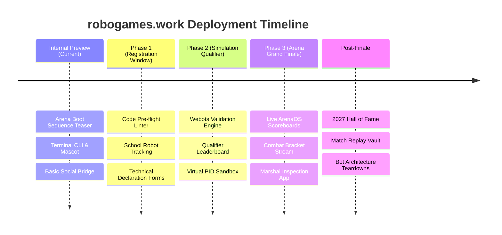

# RoboGames 2027 — Strategic Concepts & Feature Ideas (`robogames.work`)

> **Document Scope:** Ideation, architectural blueprints, and feature concepts for the `robogames.work` domain.  
> **Target Event:** RoboGames 2027 (Department of Computer Science & Engineering, University of Moratuwa & IESL).  
> **Related Specifications:** [`docs/design_spec.md`](design_spec.md) | [`docs/robogames_details.md`](robogames_details.md) | [`docs/work_summary.md`](work_summary.md)  

---

## 1. Executive Vision & Domain Role

The official academic and public portal resides at [robo.cse.mrt.ac.lk](https://robo.cse.mrt.ac.lk/). The newly acquired domain **`robogames.work`** provides a flexible, high-performance, developer-centric namespace. 

Rather than duplicating the main informational site, `robogames.work` can serve as **the active operational engine and interactive digital companion** for RoboGames 2027.

```
                    ┌───────────────────────────────┐
                    │     robo.cse.mrt.ac.lk        │
                    │   (Public & Academic Portal)  │
                    └───────────────┬───────────────┘
                                    │
                                    ▼
                    ┌───────────────────────────────┐
                    │        robogames.work         │
                    │   (Interactive Operational    │
                    │        Engine & Hub)          │
                    └───────────────┬───────────────┘
          ┌─────────────────────────┼─────────────────────────┐
          ▼                         ▼                         ▼
   [Live Arena OS]          [Participant Hub]          [OC Operations]
  Live Brackets, Scores    Code Sandbox, Webots      Inspection App, Judge
  & Combat Telemetry       Telemetry, Robot Delivery  Pads & Accreditation
```

---

## 2. Strategic Pillars & Feature Concepts

### Pillar 1: ArenaOS — Live Tournament Dashboard & Telemetry
*A real-time, broadcast-ready arena display and spectator companion for the finale at University of Moratuwa.*

* **Dynamic BattleBots Knockout Bracket:**
  * Real-time interactive tournament tree updating match outcomes instantly.
  * Bot status indicators: Active, Knockout (KO), Judges' Decision, Withdrawn.
* **Live Arena HUD & Match Telemetry:**
  * Synchronized 3-minute combat countdown timer with audio buzzer triggers.
  * Active hazard status (Arena pit status, floor flippers, perimeter warning lights).
  * Real-time judge scoring breakdown (Aggression, Damage, Control).
* **University Pathfinding & Time-Trial Leaderboard:**
  * Live lap timing and checkpoint progress for autonomous rover runs.
  * Side-by-side run comparisons with automated penalty calculation.
* **Low-Latency Live Stream Overlay Companion:**
  * Embedded video feed with interactive telemetry overlays, spectator chat, and poll predictions ("Who wins Bout #12?").

---

### Pillar 2: RoboWork — Participant Portal & Validation Sandbox
*An engineering portal empowering teams across the School, University, and Open categories.*

* **Webots Automated Code Linter & Pre-flight Checker:**
  * Participants upload their simulation controller scripts (`Python` / `C++`).
  * Automated serverless sandbox executes syntax checks, library dependency verification, and scene time-step validation (`basicTimeStep` between 8 and 16 ms) before official submission.
* **School Hardware Distribution Tracker:**
  * Qualified school teams track the real-time courier dispatch of their mailed custom RoboGames line-following physical robot.
  * Includes downloadable printable arena blueprint schematics (1:1 scale markings) and step-by-step unboxing/flashing guides.
* **BattleBots Weight Class & Safety Declaration Tool:**
  * Teams enter weapon RPM, armor thickness, battery chemistry, fail-safe radio protocols, and center of gravity calculations.
  * System outputs an automated "Technical Declaration Sheet" with a QR code for on-site inspection marshals.

---

### Pillar 3: Interactive 3D Digital Twin & Visualizer
*Leveraging Three.js / WebGL to bring the physical robots and arenas directly into the browser.*

* **Interactive Arena 3D Explorer:**
  * Walkthrough of the physical University of Moratuwa arena floor.
  * Toggle between School line-following obstacle track, University autonomous grid, and the polycarbonate BattleBots combat enclosure.
* **3D Robot Model Inspector:**
  * Interactive 3D inspection of the official mascots and past championship robots with 360-degree rotation, wireframe views, and x-ray component callouts.
* **Virtual PID Control Sandbox:**
  * A light mini-simulator where school students tune Proportional-Integral-Derivative (PID) line-follower parameters in real-time and observe robot stability over curves and junctions.

---

### Pillar 4: OC Operations Suite & Technical Marshal Tools
*Internal, authenticated workflows for the Organizing Committee to streamline event-day logistics.*

* **Marshal On-Site Inspection App:**
  * Mobile-optimized checklist for BattleBots marshals at Moratuwa:
    * Weight verification (±50g tolerance).
    * Radio fail-safe test (remote transmitter power-off test).
    * Battery securement & master power disconnect switch check.
    * Weapon lock pin verification.
  * QR code pass generation: only verified bots receive arena access clearance.
* **Digital Judge Scoring Tablets:**
  * Touch-optimized interface for competition judges to score bouts in real time across standardized criteria.
  * Instant aggregation of judge tallies with anti-bias parity validation.
* **Delegate & Team Accreditation Check-in:**
  * Fast QR code scanning at entrance gates for participant badges and lunch tokens.

---

### Pillar 5: Hall of Fame & Engineering Archive
*Preserving and celebrating the legacy of RoboGames from 2018 through 2027.*

* **Championship Bot Archive:**
  * High-definition gallery and technical teardown articles of winning robots from previous seasons (2018, 2019, 2023, 2025/2026).
  * CAD drawings, schematics, and component breakdowns shared by alumni.
* **Arena Combat Replays & High-Impact Clips:**
  * Curated video vault of classic BattleBots collisions, buzzer-beater line follower finishes, and memorable engineering breakthroughs.
* **Alumni & Engineering Spotlight:**
  * Interviews with past competitors who transitioned from RoboGames into international robotics research, aerospace, and high-tech industries.

---

### Pillar 6: Gamified Teaser Evolution (Pre-Launch Ideas)
*Fun, high-engagement micro-features that can be progressively added to the existing teaser page.*

* **Terminal ASCII Robot Battle Mini-Game:**
  * Typing `battle` or `arena` into the current `terminal@robogames.work:~` launches an ASCII-rendered mini-game where the user dodges arena hazards or programs a simple line-follower.
* **Daily Telemetry Easter Eggs:**
  * Hidden terminal commands (e.g., `moratuwa`, `matrix`, `turbo`, `sithum`, `induru`) triggering easter-egg terminal outputs, sound effects, or mascot animations.
* **Interactive Frequency Tuner:**
  * An interactive retro dial or slider to "tune" the frequency on `robogames.work`, revealing secret event teasers, hardware schematics, or audio transmissions.

---

## 3. Recommended Phased Implementation Roadmap



| Phase | Milestone | Key Features on `robogames.work` | Target Users |
| :--- | :--- | :--- | :--- |
| **Phase 0 (Current)** | **Teaser Staging** | Arena Boot Sequence terminal, mascot widget, main portal bridge | OC & Internal Testers |
| **Phase 1** | **Registration & Build** | Team workspace, BattleBots declaration generator, School kit tracking | Registered Competitors |
| **Phase 2** | **Simulation Qualifier** | Webots automated file validator, real-time qualification scoreboard | School & University Teams |
| **Phase 3** | **Live Grand Finale** | ArenaOS live combat brackets, judge scoring app, live stream telemetry | On-site Audience & Spectators |
| **Phase 4** | **Legacy Archive** | Hall of Fame, match analytics, open-source code repositories | Public & Robotics Community |

---

## 4. Technical Stack Fit & Architecture

To ensure high performance, low maintenance, and smooth scaling on match day:

* **Frontend:** Next.js (App Router) + TypeScript + Vanilla CSS / CSS Modules.
* **State & Live Telemetry:** WebSockets / Server-Sent Events (SSE) or Supabase Realtime for instant bracket and timer synchronization during arena matches.
* **Hosting:** Cloudflare Pages or Vercel Edge Network for rapid global static caching and DDoS protection.
* **Data Layer:** Lightweight PostgreSQL / Supabase or Firebase for match results, inspection checkmarks, and team telemetry.
* **3D Graphics:** Three.js / React Three Fiber for interactive robot previews and arena digital twins.
